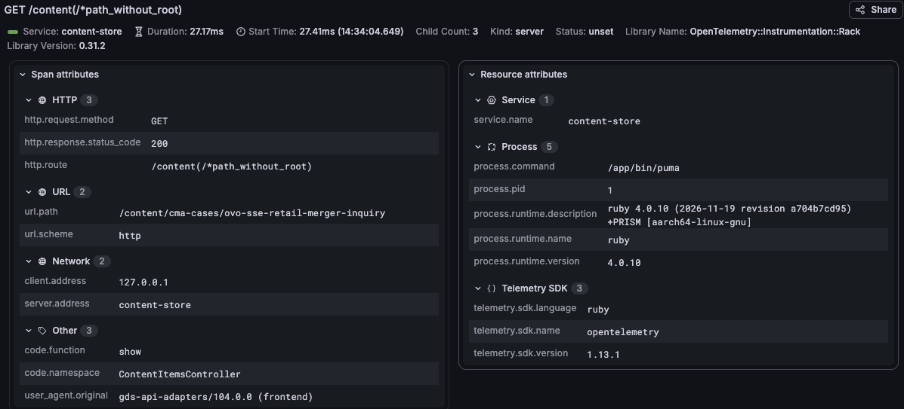

Ruby apps emit traces through OpenTelemetry via the [govuk_app_config](https://github.com/alphagov/govuk_app_config/blob/main/lib/govuk_app_config/govuk_open_telemetry.rb).
Grafana Tempo ingests these traces and stores them in S3.

## Access Tempo

Tempo allows us to query these traces by writing TraceQL queries.

1. Select explore in [Grafana](https://grafana.eks.production.govuk.digital/explore)
1. In the drop-down menu select **Tempo**
1. In Query Type select **TraceQL**

## Write a TraceQL query

[TraceQL documentation](https://grafana.com/docs/tempo/latest/traceql/) provides examples on how to write queries.

```
{ }
```

Select **Run Query** and it will return all the traces. If you click on a `traceID` it will show you the spans inside it:



To see all the available `span` attributes to query on type in `{ span.` and a drop-down menu will appear. To see all the available `resource`
attributes to query on type in `{ resource.` and a drop-down menu will appear.

### Retrieve traces for a specific govuk-request-id

```
{span.http.request.header.govuk_request_id ="2143"}
```

### Retrieve traces where the service return a 200 status code

```
{ span.http.response.status_code = 200 }
```

### Retrieve traces which contain a database query

```
{ span.db.statement != "" }
```

### Retrieve traces from a particular service

```
{ resource.service.name = "asset-manager"}
```
